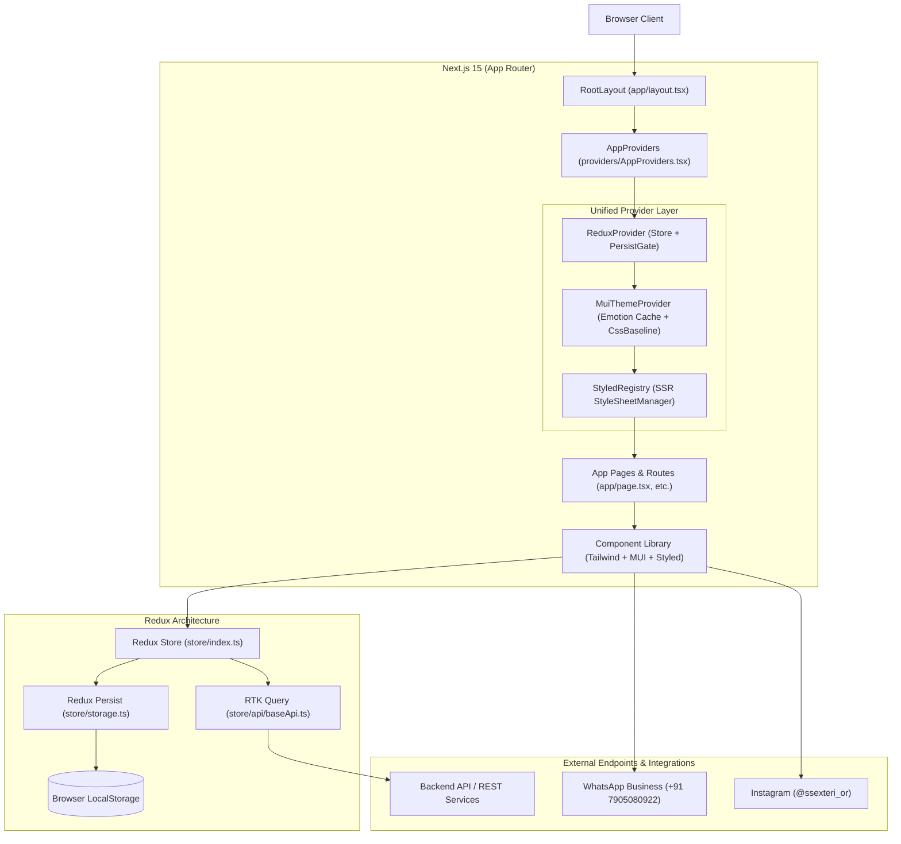

# System Architecture Document

## 1. Architecture Overview

The SS Exterior platform is built on an enterprise-grade modular architecture utilizing **Next.js 15 (App Router)** with **React 19**, **TypeScript**, **Redux Toolkit & RTK Query**, **Redux Persist**, **Tailwind CSS**, **Material UI (MUI v6)**, and **Styled-Components**.



---

## 2. Directory Structure & Responsibilities

```text
src/
├── app/                    # Next.js App Router (pages, layouts, error boundaries, routes)
│   ├── layout.tsx          # Root Layout: Metadata, font loading, unified AppProviders
│   ├── page.tsx            # SS Exterior Home & Showcase (Hero, Services, Contact)
│   ├── loading.tsx         # Suspense Skeleton for seamless loading states
│   ├── not-found.tsx       # Custom branded 404 page
│   ├── error.tsx           # Error Boundary with state recovery reset
│   └── globals.css         # Tailwind directives (@tailwind base/components/utilities)
│
├── components/             # Reusable UI component library
│   ├── common/             # Atomic components (Button.tsx, Card.tsx)
│   ├── layout/             # Application chrome (Navbar.tsx, Footer.tsx)
│   └── styled/             # Styled-components primitives (StyledElements.tsx)
│
├── config/                 # Central configuration
│   ├── env.ts              # Strongly typed environment validation
│   ├── site.ts             # SS Exterior business metadata, contact, address, GST
│   └── constants.ts        # Storage keys, debounce intervals, pagination limits
│
├── features/               # Domain-driven feature modules
│   ├── counter/            # Feature: Persisted Redux counter demo
│   ├── posts/              # Feature: RTK Query caching & live feed
│   └── theme/              # Feature: Dark/Light theme mode slice
│
├── hooks/                  # Custom React hooks (useMediaQuery.ts, useDebounce.ts)
│
├── providers/              # Application provider tree
│   ├── AppProviders.tsx    # Unified wrapper uniting Redux, MUI, and Styled-Components
│   ├── ReduxProvider.tsx   # Redux Store + PersistGate with SSR safety
│   ├── MuiThemeProvider.tsx# MUI AppRouterCacheProvider + ThemeProvider + CssBaseline
│   └── StyledRegistry.tsx  # Styled-Components ServerStyleSheet SSR collector
│
├── store/                  # State Management
│   ├── index.ts            # Redux store with custom middleware & persistor
│   ├── rootReducer.ts      # Reducer combination with whitelist/blacklist policy
│   ├── hooks.ts            # Typed useAppDispatch & useAppSelector hooks
│   ├── storage.ts          # SSR-safe localStorage fallback engine
│   └── api/                # RTK Query base API
│       └── baseApi.ts      # Base query, cache tags ('Posts', 'User')
│
├── styles/                 # Visual themes
│   └── theme/              # MUI theme palette (Indigo/Bronze/Slate) & overrides
│
├── types/                  # Global TypeScript definitions
│   ├── api.ts              # API contracts, responses, and post models
│   └── common.ts           # UI component props and common types
│
└── utils/                  # Helper functions
    └── cn.ts               # Tailwind CSS class merging (clsx + twMerge)
```

---

## 3. Core Architectural Patterns

### 3.1 SSR-Safe Redux Persistence
In Next.js, executing `localStorage.getItem` during server-side rendering results in hydration mismatch errors (`window is not defined`). 
- **Solution (`src/store/storage.ts`):** Implements an environment check returning a `noopStorage` during SSR and binds dynamically to `window.localStorage` on client hydration.
- **Cache Isolation:** RTK Query cache slices are explicitly blacklisted from persistence in `rootReducer.ts` to prevent stale offline caching.

### 3.2 Dual Styling Engine (MUI + Tailwind + Styled-Components)
To prevent Flash of Unstyled Content (FOUC) and CSS specificity conflicts:
1. **Material UI (MUI v6):** Wrapped with `@mui/material-nextjs/v15-appRouter` (`AppRouterCacheProvider`) ensuring Emotion styles are collected and inserted into the HTML stream.
2. **Styled-Components v6:** Managed by `StyledRegistry.tsx` using `useServerInsertedHTML` from `next/navigation` and enabled SWC compiler transform in `next.config.mjs`.
3. **Tailwind CSS v3:** Configured with PostCSS to provide utility styling alongside components without interfering with Emotion or Styled-Components stylesheets.
